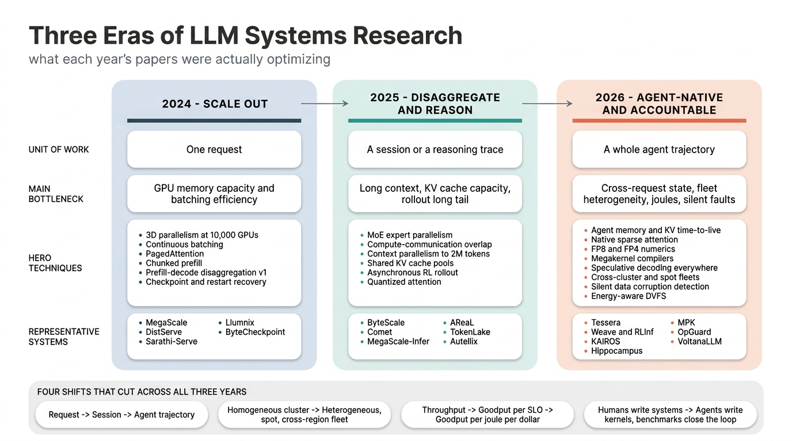
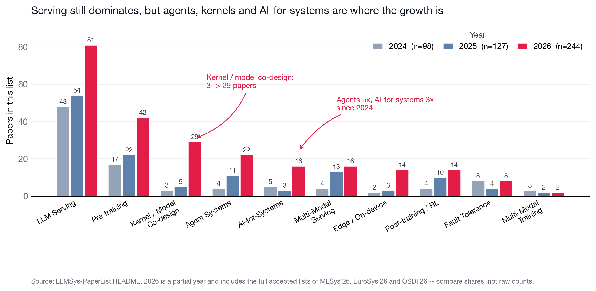
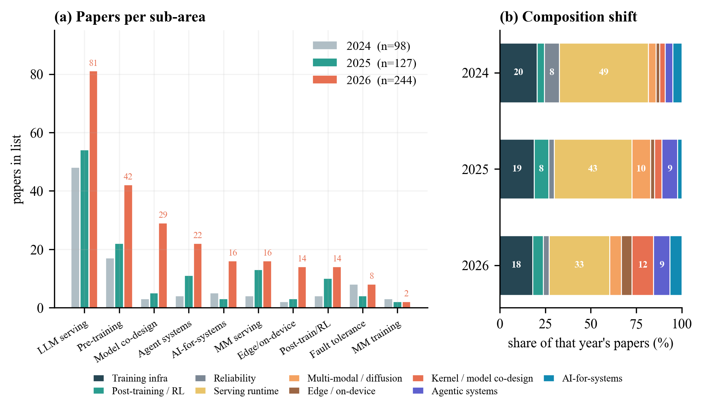

# LLM Systems Research Trends, 2024 → 2026

A quantitative and technical read of the papers collected in [the main list](../README.md):
what the field optimized each year, which techniques rose and fell, and where 2026 is going.

## Contents of this directory

| File | What it is |
|---|---|
| `fig_era_evolution_attempt2.png` | The three eras of LLM-systems research, side by side (Gemini 3 Pro Image) |
| `fig_landscape.png` / `.pdf` | Papers per sub-area per year, with the two structural shifts called out |
| `fig_area_shift.png` / `.pdf` | The same counts plus the normalized composition shift |
| `extract_trends.py` | Parses `../README.md` into `trends.json` (year attribution + technique keywords) |
| `gen_fig_*.py` | Figure generators. `gen_fig_trends.py` and `gen_fig_landscape.py` read `trends.json`; `gen_fig_era_evolution.py` and `gen_fig_2026_stack.py` call the Gemini image API (needs `GEMINI_API_KEY`) |
| `trends.json` | The extracted statistics behind every number below |

Reproduce with:

```bash
python3 trends/extract_trends.py     # README.md -> trends.json
python3 trends/gen_fig_trends.py     # fig_area_shift (+ other charts)
python3 trends/gen_fig_landscape.py  # fig_landscape
```

**How to read the numbers.** 470 entries are year-attributed by (1) the list's own year bucket,
(2) the venue tag, (3) the arXiv `YYMM` id, in that order: **98 papers for 2024, 127 for 2025,
244 for 2026**. The 2026 count is inflated by coverage, not by reality — it contains the full
accepted lists of MLSys'26 (82), EuroSys'26 (47) and OSDI'26 (43), and the year is only half over.
**So read share-of-year, never absolute counts.** Technique labels come from keyword matching on
title + blurb, so a paper can match several themes.

---

## 1. The headline: three eras



The most useful lens is *what unit of work the system optimizes*.

- **2024 — Scale out.** The unit is **one request**. Systems assumed a homogeneous cluster and a
  stateless request stream, and the wins came from packing that stream better: continuous batching,
  PagedAttention, chunked prefill (Sarathi-Serve), the first prefill/decode split (DistServe),
  10K-GPU 3D parallelism (MegaScale), multi-tenant LoRA (Punica, S-LoRA, dLoRA), crash recovery
  (ByteCheckpoint, ReCycle).
- **2025 — Disaggregate and reason.** The unit becomes **a session or a reasoning trace**. MoE and
  long context break the single-node assumptions: expert parallelism gets its own serving system
  (MegaScale-Infer), context parallelism reaches 2M tokens (ByteScale), compute and communication
  fuse at the kernel level (Comet, TileLink), the KV cache is promoted from a buffer to a shared pool
  (TokenLake, CacheBlend), and RL post-training becomes a systems problem in its own right
  (AReaL, StreamRL, APRIL, RhymeRL).
- **2026 — Agent-native and accountable.** The unit is **a whole agent trajectory**: many turns, tool
  calls, branches, and KV state with a lifetime. Simultaneously the substrate stops being uniform
  (heterogeneous, spot, cross-region fleets) and the objective grows two terms that used to be
  footnotes: **joules** and **silent correctness**.

Four shifts cut across all three years:

| Shift | 2024 | 2026 |
|---|---|---|
| Unit of optimization | request | agent trajectory |
| Substrate assumption | homogeneous cluster | heterogeneous / spot / cross-region fleet |
| Objective | throughput | goodput per joule per dollar, *under a correctness guarantee* |
| Who writes the system | humans | humans + LLM agents, with benchmarks as the control loop |

---

## 2. Where the mass moved





Serving is still the largest single area in absolute terms (48 → 54 → 81 papers), but its
**share collapsed from 49% to 33%**. Nothing about serving got less important; the field broadened
faster than serving grew. The share went to four places:

- **Kernel / model co-design: 3% → 12%** (3 → 5 → 29 papers) — the biggest structural gain.
- **Agentic systems: 4% → 9%** (4 → 11 → 22).
- **AI-for-systems: 5% → 7%** (5 → 3 → 16), i.e. LLMs building systems.
- **Edge / on-device: 2% → 6%** (2 → 3 → 14), almost entirely mobile NPU and local-MoE work.

Two things are notable because they are *not* growing. **Multi-modal training systems** have been
flat at 2–3 papers a year since 2024 while multi-modal *serving* grew to 16 — an asymmetry that looks
like an open opportunity. And **fault tolerance** is flat as a label (8 → 4 → 8), which is misleading:
its content changed completely (§4.7).

---

## 3. Which techniques rose and fell

Share of that year's papers matching each technique:

| Technique | 2024 | 2025 | 2026 | Δ (pp) |
|---|---|---|---|---|
| Agentic / multi-agent | 1.0% | 7.9% | **13.1%** | +12.1 |
| Compiler / kernel / megakernel | 0.0% | 3.1% | **10.2%** | +10.2 |
| Speculative decoding | 1.0% | 0.0% | 5.7% | +4.7 |
| Sparse attention | 1.0% | 1.6% | 4.5% | +3.5 |
| MoE / expert parallelism | 4.1% | 3.9% | 7.4% | +3.3 |
| Heterogeneous / cross-cluster / spot | 6.1% | 7.9% | 9.0% | +2.9 |
| Quantization / low precision | 2.0% | 4.7% | 4.5% | +2.5 |
| Energy / power / thermal | 1.0% | 0.8% | 3.3% | +2.3 |
| Prefill-decode disaggregation | 3.1% | 6.3% | 5.3% | +2.2 |
| Benchmark / profiling / characterization | 4.1% | 4.7% | 6.1% | +2.0 |
| Communication / collectives / network | 5.1% | 4.7% | 6.6% | +1.5 |
| RAG / retrieval / vector search | 1.0% | 5.5% | 2.5% | +1.5 (peaked 2025) |
| Memory offload / hierarchy | 4.1% | 6.3% | 4.9% | +0.8 |
| Long-context / seq+ctx parallelism | 5.1% | 7.1% | 4.5% | −0.6 |
| Scheduling / SLO / goodput | 11.2% | 8.7% | 9.4% | −1.8 |
| Serverless / elastic / cold start | 6.1% | 8.7% | 3.7% | −2.4 |
| KV cache / context reuse | 7.1% | 3.9% | 4.1% | −3.0 |
| Reliability / fault tolerance / SDC | 10.2% | 8.7% | 7.0% | −3.2 |

Three of these movements are *substitutions*, not deaths, and that is the interesting part:

1. **Long-context parallelism → sparse attention.** 2025 answered long context by splitting the
   sequence across more devices. 2026 answers it by not attending to most of it. Long-context share
   fell while sparse-attention share nearly tripled.
2. **RAG → agentic.** RAG peaked as a standalone systems topic in 2025 (5.5%) and fell to 2.5% while
   agentic went to 13.1%. Retrieval did not become less important; it became a subroutine inside an
   agent, and the paper title moved up a level.
3. **KV cache management → KV cache as infrastructure.** Fewer papers about *how to page a KV cache*,
   more that assume a hierarchical cache tier exists and attack its bandwidth, lifetime and locality
   (Strata, ECHO, DualPath, span queries).

---

## 4. 2026 in depth

The 2026 stack, layer by layer:

| Layer | What 2026 builds there |
|---|---|
| **Agent runtime** | agent memory and KV time-to-live, declarative agent specs, async tool-call concurrency, computer-use agents, structured output engines |
| **RL post-training plane** | disaggregated rollout + training, async off-policy pipelines, speculative drafters in rollout, preemptible/spot harvesting, role-based fault tolerance |
| **Serving runtime** | prefill-decode and EPD disaggregation, hierarchical KV cache pools, speculative decoding, SLO/goodput scheduling, elastic autoscaling and cold start |
| **Parallelism and fleet** | heterogeneous auto-parallelism, MoE expert parallelism, context/sequence parallelism, cross-cluster and cross-region, spot and decentralized capacity |
| **Compiler and kernel** | megakernels, tile-level languages, sparse attention kernels, compute-communication overlap, CUDA graph and runtime codegen |
| **Hardware substrate** | Blackwell-class GPUs and superchips, PIM/CXL/near-data memory, SRAM-resident pipelines, RDMA and multipath fabric, mobile NPUs |

Cutting through every layer: **energy and power** (joules per token), **reliability and silent data
corruption** (correctness, not just uptime), **cost and elasticity** (dollars per goodput), and
**measurement and skepticism** (does the trick actually help). Feeding back into the compiler layer
from the top: the **AI-for-systems flywheel** — agents generate kernels and configs, benchmarks
verify and redeploy.

### 4.1 Scheduling moved from requests to trajectories

2024–25 schedulers optimized per-request TTFT/TBT. 2026 systems explicitly model that one agent turn
is one of N turns sharing state, and that the sharing pattern is a *tree*, not a stream: KAIROS
(stateful, context-aware agentic serving), ThunderAgent (program-aware execution), AgenticCache
(cache-driven asynchronous planning), FlashAgents (streaming prefill overlap across agents), Nalar
(separating workflow specification from execution), Hippocampus (agent memory as a first-class system
component), Vortex (programmable sparse attention *for agents*).

The technical consequence: prefix-cache hit rate stops being the right metric. What matters is
**KV lifetime and eviction policy under branching** — what Continuum (KV cache time-to-live, late
2025) opened and 2026 built on. Once KV state must survive across turns the bottleneck moves to the
storage path: DeepSeek's DualPath attacks *storage bandwidth* in agentic inference, Strata does
hierarchical context caching, ECHO does offloading with lossless prefetch, "No Buffer, No Bottleneck"
does zero-copy offload.

A second consequence is a push toward **declarative agent interfaces**, because a runtime cannot
schedule what it cannot see: "Serve Programs, Not Prompts" (2025), XGrammar-2, Nalar, SemWeave
(semantic common subexpressions for LLM query processing), Agent JIT Compilation, "From Imperative to
Declarative" (LLM-friendly OS interfaces for computer-use agents), future-based async function
calling. Same arc databases went through: hand-written imperative plans → declared intent + planner.

### 4.2 RL post-training became an online serving workload

The clearest technical signature of 2026 is **speculative decoding inside RL rollout**: ReSpec,
"Beat the Long Tail: Distribution-Aware Speculative Decoding for RL", "Taming the Long-Tail:
Efficient Reasoning RL Training with an Adaptive Drafter", and Aurora, which unifies training and
serving around adaptive speculative training. The reasoning is specific: rollout is generation-bound
with a heavy tail, the drafter can be distilled from the policy itself, and because the policy drifts
every step the drafter must adapt *online* — a problem that does not exist in inference-only
speculative decoding.

Around it, the RL stack got the full serving-systems treatment: disaggregated rollout/training
co-scheduling (Weave), macro-to-micro flow transformation (RLinf), dynamic scheduling (DynaRL),
disaggregated multi-task agentic RL (RollArt), async pipelines (Laminar), dataflow-oriented agentic
RL (AstraFlow), heterogeneous environments (HetRL), preemptible-capacity harvesting (RLBoost),
role-based fault tolerance (RobustRL). **The training/serving boundary is dissolving** — which is
also why training-inference numerical mismatch became a correctness topic (§4.7).

### 4.3 Heterogeneity is now the default assumption

2024 planners searched over parallelism degrees for identical devices. 2026 planners search over
**assignments to non-identical devices**: Tessera (trillion-parameter heterogeneous MoE pipelines),
Hetu v2 (hierarchical + heterogeneous SPMD annotations), HexiScale, Zorse, HetAuto and HARP
(cross-cluster auto-parallelism), AXLearn (modular training on heterogeneous infrastructure), Suika
(re-scheduling 3D-parallel jobs in shared clusters); on the serving side OpenTela (decentralized
resources), Coral and BOute (heterogeneous models × heterogeneous GPUs), SkyWalker (cross-region load
balancing), SkyNomad (multi-region spot), WWW.Serve (decentralized global serving). Alibaba's
"Heterogeneity at Hyperscale" characterizes why: a production fleet is a mix of GPU generations, not
a uniform pool.

This changes the *shape* of the problem and explains an otherwise odd 2026 cluster: the search space
became too large and irregular for hand tuning, so automated configuration papers appeared —
AIConfigurator, AutoScout, OptiKIT, "Optimizing Deployment Configurations for LLM Inference", BOute
(multi-objective Bayesian optimization). Auto-parallelism is back, but the objective is cost and SLO
on a mixed fleet rather than throughput on a uniform one.

### 4.4 The kernel/compiler layer is the fastest-growing layer, and megakernels are the organizing idea

0% → 3.1% → 10.2% in two years. Two forces converge:

- **Low-latency decode is launch-bound**, so fuse the whole forward pass into one persistent kernel:
  MPK (mega-kernelizing tensor programs into a single multi-GPU kernel), Event Tensor (a unified
  abstraction for compiling *dynamic* megakernels), plus the CUDA-graph line — GraCE (compiler support
  for CUDA graphs), Foundry (template-based CUDA-graph context materialization to kill cold start).
- **Model architectures change faster than hand-written kernels can keep up**, so raise the
  abstraction: Tilus (tile-level GPGPU language for low precision), Hexcute (automated layout
  synthesis), TileLoom (dataflow planning for tile languages), Flashlight (PyTorch compiler extensions
  for attention variants), Prism (symbolic superoptimization of tensor programs), Syncopate (automatic
  chunk-centric compute/communication overlap), VTC (virtual tensors to eliminate data movement),
  FuseFlow and Streaming Tensor Programs for dataflow accelerators.

### 4.5 Sparse attention became the long-context answer, co-designed with the KV store

The important detail is *where* the sparsity lives. Models now ship with **native** sparse attention,
so serving systems must serve sparsity rather than tolerate it: ECHO explicitly targets "native sparse
attention LLMs", Vortex makes sparse attention programmable for agents, BLASST does dynamic blocked
sparsity, and OPKV, FlexiCache (temporal stability of attention heads) and span queries make the
*paged KV cache itself* sparsity-aware. FlashAttention-4 co-designs algorithm and kernel pipelining
for Blackwell's asymmetric scaling.

Low precision also crossed back into training, which is new: SageBwd (trainable low-bit attention),
SLA2 (sparse-linear attention with learnable routing and QAT), FP8-Flow-MoE (casting-free FP8 without
double quantization error), CAGE (curvature-aware gradients for QAT), MixLLM, ADAngel. 2024's
"quantize for inference" has become "train in the format you serve in".

### 4.6 Energy became a first-class SLO dimension

1.0% → 0.8% → 3.3%, and — more telling than the share — it now appears at *every* layer: training
(Kareus, joint dynamic + static energy), serving (VoltanaLLM SLO-aware energy, BiScale phase-aware
placement + DVFS, BEAM joint resource-power optimization), diagnosis ("Where Do the Joules Go?"),
mobile (CORE, rethinking DVFS for on-device LLMs), agentic (KAIROS is explicitly power-efficient
agentic serving). Datacenter power is the binding constraint, so the objective moved from
tokens/second to **tokens/second/watt subject to an SLO**.

### 4.7 Reliability shifted from crash failures to silent correctness

Classic fault tolerance shrank as a share (10.2% → 7.0%) but its content inverted. 2024 was
checkpoint/restart and elastic pipeline reconfiguration. 2026 is about being **wrong without
crashing**:

- **Silent data corruption** as a headline topic: "SDCs in the Wild" (characterizing SDC-defective
  GPUs in production LLM training), "Safeguarding LLM Training at Scale" (online SDC detection,
  insights from 35 million GPU hours), OpGuard (bitwise alignment for debugging production training).
- **Verification and determinism**: TrainVerify (equivalence-based verification of distributed
  training, 2025), deterministic inference across tensor-parallel sizes to eliminate
  training-inference mismatch, TrustWeave (integrity measurement and attestation for multi-cloud).
- **Cheaper durability and diagnosis**: GoCkpt (gradient-assisted overlapped checkpointing), sparse
  checkpointing for MoE, GhostServe (shadow checkpointing for fault-tolerant *serving*), RaidServe,
  GUARD (straggler detection), StriaTrace (tracing online inference).

Why now: at 100K-GPU scale over month-long runs a silently corrupted gradient costs more than a crash,
and RL post-training (§4.2) turns numerical mismatch between trainer and rollout engine into a
*correctness* bug rather than an annoyance.

### 4.8 Systems research started using LLM agents to build systems

`LLM for Systems` went 5 → 3 → 16 papers, and split cleanly in two:

- **Agents that generate systems code**: AccelOpt (self-improving agentic kernel optimization), AVO
  (agentic variation operators for evolutionary search over GPU attention kernels), ARGUS (agentic GPU
  optimization guided by data-flow invariants), VibeTensor (DL system software fully generated by AI
  agents), K-Search (kernel generation via a co-evolving intrinsic world model), CUCo (agentic
  compute/communication co-design), VeriMoA (spec-to-HDL), ECO (Google's AI-driven code efficiency
  optimizer for warehouse-scale computers), AI-Driven Research for Databases.
- **The benchmark harness that makes the loop trustworthy**: FlashInfer-Bench (explicitly framed as
  "building the virtuous cycle"), SOL-ExecBench (speed-of-light benchmarking against hardware limits),
  FastKernels (kernel generation in production).

The position papers say it out loud: "Barbarians at the Gate: How AI is Upending Systems Research"
(2025) → "Let the Barbarians In: How AI Can Accelerate Systems Performance Research" (2026). Note the
structure — **generator + verifier + speed-of-light benchmark**. That is the same shape as §4.2's
adaptive drafter and §4.3's automated configuration search: 2026's recurring pattern is
*search with a cheap verifier*.

### 4.9 A strong skeptical/measurement wave — the maturity signal

Benchmark and characterization work rose to 6.1%, but the titles matter more than the count:
"Speculative Decoding: Performance or Illusion?", "Beyond the Buzz: A Pragmatic Take on Inference
Disaggregation", "Inference Time Context Sparsity: Illusion or Opportunity?", "Demystifying the
Mixture of Experts Serving Tax", "Simple Is Better: Multiplication May Be All You Need for LLM Request
Scheduling", "Revisiting Pipeline Parallelism for LLM Serving", "Breaking the Ice: Analyzing Cold
Start Latency in vLLM" — plus infrastructure for measuring at all: DriftBench (infrastructure drift),
Charon (unified training+inference simulator), ProfInfer (eBPF-based profiler), VLA-Perf, OSWorld-Human
(efficiency of computer-use agents).

Read this as consolidation. The 2023–25 technique inventory is now large enough that the marginal
value of one more trick is lower than the marginal value of knowing **which tricks actually pay off in
production** — and several 2026 papers answer "less than advertised".

### 4.10 Two more 2026 currents

- **Diffusion LLMs and real-time video generation** became a genuine serving discipline. The 2025
  engines (dInfer, Fast-dLLM v2, dLLM-Serve) are followed in 2026 by d3LLM, CDLM, TiDAR and SpecDiff-2
  for diffusion-LM decoding; StreamDiffusionV2, SlackServe, MonarchRT and Quant VideoGen for
  streaming/interactive video; TriInfer and Cornserve for encode-prefill-decode disaggregation of
  any-to-any models.
- **New silicon assumptions**, continuing 2025's PIM/CXL/NDP line ("PIM Is All You Need", NDP-DIMM,
  WaferLLM) into 2026: superchips (SuperOffload, SuperInfer), SRAM-resident pipelines (SHIP), Sieve
  (PIM for evolving MoE), and on the network side RDMA point-to-point, multipath collectives beyond
  scale-up networks, and UCCL-Tran — successors to 2025's 100K+-GPU collective work.

---

## 5. The industrial-report signal

A different trend, visible in the same list. Detailed technical reports peaked in **2024 (45)** and
fell to **17 in 2025** and **10 so far in 2026**:

| Year | US labs | Chinese labs | EU / other | Total |
|---|---|---|---|---|
| 2023 | 7 | 3 | 3 | 13 |
| 2024 | 22 | 16 | 7 | **45** |
| 2025 | 7 | 10 | 0 | 17 |
| 2026 (partial) | 3 | 5 | 2 | 10 |

Two shifts inside that decline:

- **The US share collapsed** (22/45 in 2024 → 3/10 in 2026). Open-weight technical reporting is now
  led by Chinese labs — Alibaba alone accounts for 4 of the 10 2026 entries.
- **The genre changed.** 2024 reports announced flagship base models. The 2026 entries are
  *specialized* (Qwen3-ASR, Qwen3-VL-Embedding/Reranker, TranslateGemma, Granite Embedding, Nemotron 3
  Nano Omni) or *explicitly agentic* (GLM-5: "from Vibe Coding to Agentic Engineering", following
  Kimi K2: "Open Agentic Intelligence", 2025). Frontier labs largely stopped publishing training
  details, which makes the production-characterization papers of §4.9 more valuable, not less.

---

## 6. What is conspicuously missing

Gaps the 2026 list makes visible, offered as research openings:

1. **Multi-modal training systems** — 2–3 papers a year against 16 on multi-modal serving, even though
   any-to-any models are shipping (only MegaScale-Omni, Entrain, PipeWeaver, Cornstarch).
2. **Agent memory as a storage system** — Hippocampus and the ontology-guided memory paper are nearly
   alone; there is no consistency model, no eviction theory, no benchmark for cross-session state.
3. **Cost/energy accounting for agent trajectories** — energy work is per-token and per-request;
   nothing attributes joules or dollars to a *trajectory* with retries, branches and tool calls.
4. **Verification for the AI-for-systems loop** — SOL-ExecBench and FlashInfer-Bench check performance,
   but nothing establishes *semantic* correctness of agent-generated kernels at the level
   OpGuard/TrainVerify demand of human-written ones.
5. **Multi-tenant fairness on heterogeneous fleets** — fairness (VTC, 2024) predates the heterogeneity
   turn; what fairness means across non-identical devices is open, and Quota Marketplace (OSDI'26) is
   an early, isolated attempt.
